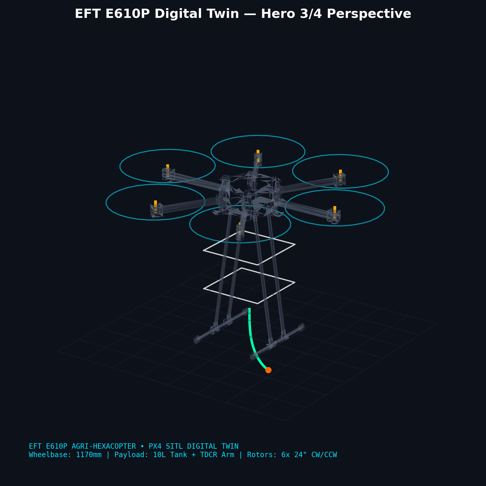
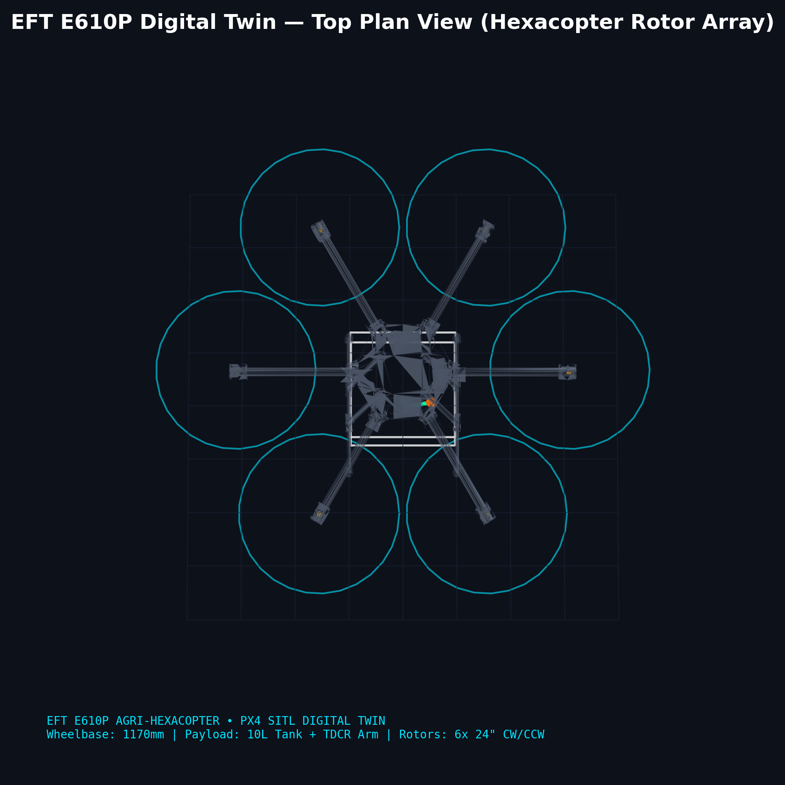
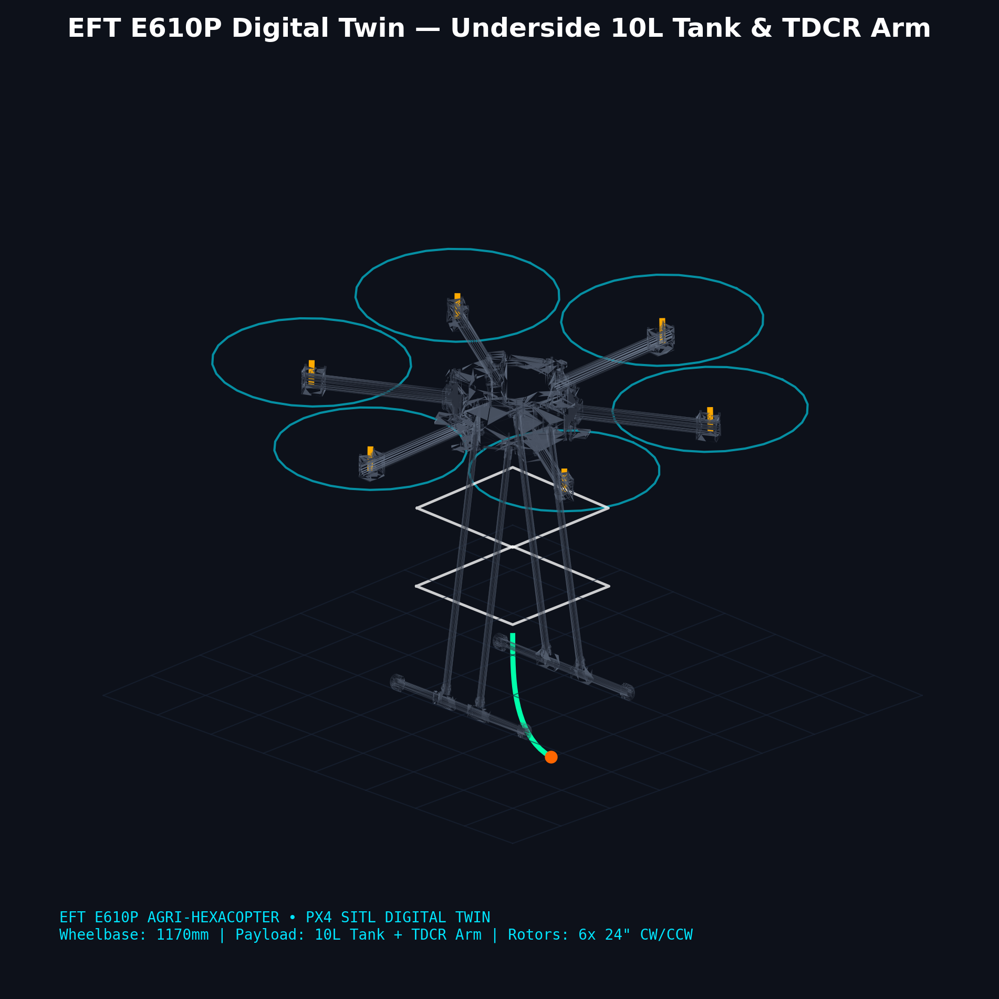
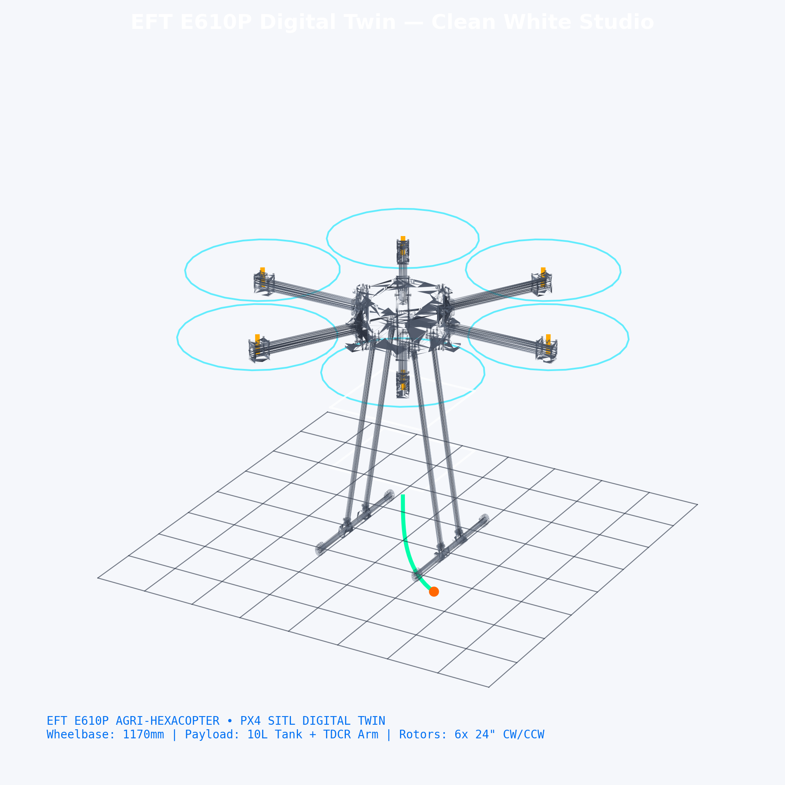
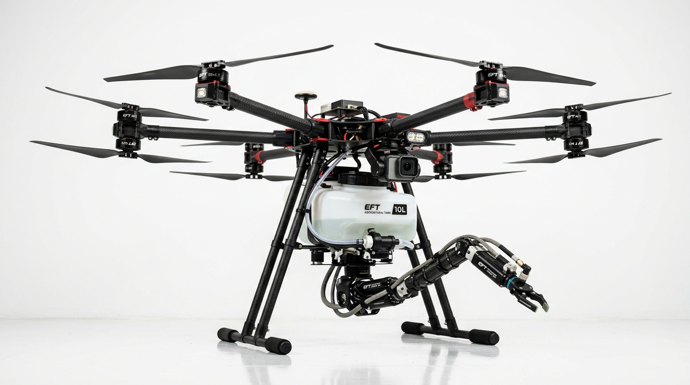
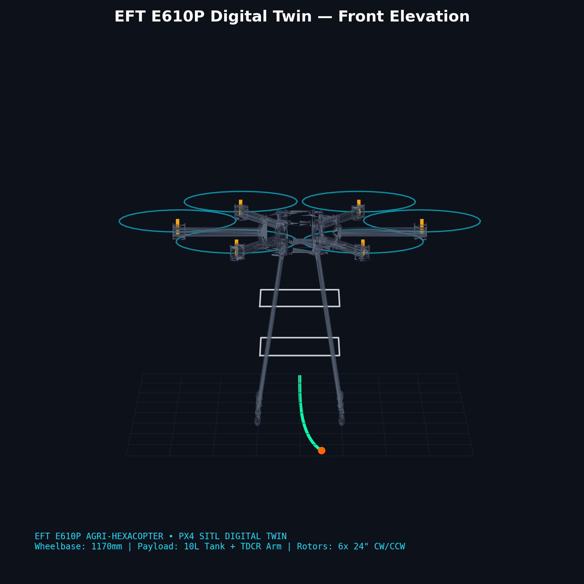
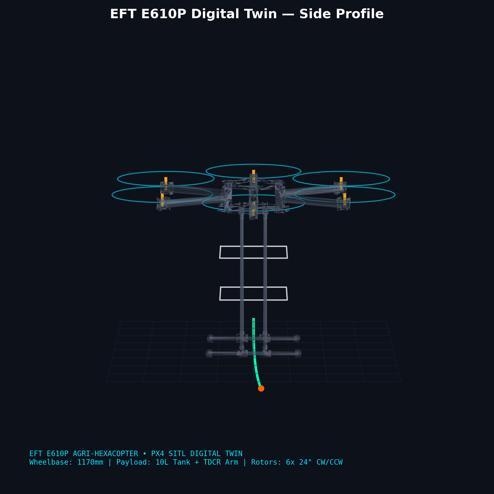

# Aerial Manipulator for Precision Agriculture

This repository contains the ROS 2 packages, PX4 customizations, MuJoCo arm model and
visualization tools for the **EFT E610P** agricultural multirotor simulation.

| | | |
|---|---|---|
|  |  |  |

## Repository Structure
* **`eft_ws/`**: ROS 2 workspace containing:
  * **`eft_control`**: ROS 2 package with MAVLink/offboard teleop bridges, the waypoint and flight-profile controllers, URDF definitions, and RViz2 launch configurations.
  * **`px4_msgs`**: ROS 2 PX4 message interfaces.
* **`px4_customizations/`**: customized PX4 SITL files:
  * **`airframes/`**: multi-rotor control allocator configuration (`22000_gz_eft_e610p`).
  * **`models/`**: visual models and dynamics parameters (`eft_e610p`).
* **`mujoco_tdcr/`**: MuJoCo model and scripts for the tendon-driven continuum robot (TDCR) arm used in the co-simulation.
* **`eft_studio/`**: EFT E610P Digital Twin Studio, a browser-based 3D viewer and photo tool.
* **`renders/`**: rendered images of the EFT E610P (captured with the Digital Twin Studio).

## Prerequisites
Ubuntu 24.04 with **ROS 2 Jazzy** and **Gazebo Harmonic**, plus these tools installed separately (they are not part of this repository):

| Tool | Default location | Used by |
|---|---|---|
| [PX4-Autopilot](https://github.com/PX4/PX4-Autopilot) (SITL built) | `~/PX4-Autopilot` | all launches |
| [Micro XRCE-DDS Agent](https://github.com/eProsima/Micro-XRCE-DDS-Agent) | `MicroXRCEAgent` on the `PATH` (after `sudo make install`), else `~/Micro-XRCE-DDS-Agent/build/MicroXRCEAgent` | all launches |
| [QGroundControl](https://qgroundcontrol.com) AppImage | `~/Downloads/QGroundControl-x86_64.AppImage` | QGC launches |
| ROS 2 `joy` package (`sudo apt install ros-jazzy-joy`) and a FlySky FS-i6X over USB | – | joystick / FS-i6X launches |
| MuJoCo for Python (`pip install mujoco`) | – | MuJoCo co-simulation |

**Installed somewhere else?** No paths need editing. Point the launch files to your installation with a launch argument or an environment variable:

| Tool | Launch argument | Environment variable |
|---|---|---|
| PX4-Autopilot folder | `px4_dir:=$HOME/path/to/PX4-Autopilot` | `export PX4_DIR=...` |
| Micro XRCE-DDS Agent | `xrce_agent:=$HOME/path/to/MicroXRCEAgent` | `export MICRO_XRCE_AGENT=...` |
| QGroundControl AppImage | `qgc_path:=$HOME/path/to/QGroundControl.AppImage` | – |

All commands below are run from the root of the cloned repository, wherever you cloned it.

## Setup Instructions

### 1. Copy PX4 Customizations
To load the custom EFT E610P airframe and physical visuals into your local `PX4-Autopilot` installation:
```bash
# Copy airframe posix setup
cp px4_customizations/airframes/22000_gz_eft_e610p ~/PX4-Autopilot/ROMFS/px4fmu_common/init.d-posix/airframes/

# Copy visual model, meshes, and SDF parameters
cp -r px4_customizations/models/eft_e610p ~/PX4-Autopilot/Tools/simulation/gz/models/
```

### 2. Build ROS 2 Workspace
```bash
cd eft_ws
colcon build --symlink-install
source install/setup.bash
```

## Launching Simulations

Before launching any configuration, make sure you have built and sourced the workspace as described above.

### 1. Waypoint Flight (Gazebo Simulation only)
Starts the Gazebo simulation and the autonomous waypoint navigation controller.
```bash
ros2 launch eft_control waypoint_flight.launch.py
```

### 2. Waypoint Flight with MuJoCo (Co-simulation)
Starts the drone waypoint navigation in Gazebo and triggers the MuJoCo-simulated bending arm at targets.
* **Terminal 1: Start simulation and controllers**
  ```bash
  ros2 launch eft_control waypoint_flight_mujoco.launch.py
  ```
* **Terminal 2: Run the MuJoCo simulation script** (from the repository root)
  ```bash
  source /opt/ros/jazzy/setup.bash
  cd mujoco_tdcr
  python3 simulate_ros.py
  ```
  The arm bends when the drone reaches a target (topic `/drone/at_tree`).

### 3. QGroundControl (QGC) Teleoperation
Launches the full simulation and boots up the QGroundControl application. By default it also runs the **flight profile player**, which replicates a physical flight log in Gazebo: takeoff and low hover (~0.8 m), reposition with a slight yaw, climb to 3 m, active station keeping inside a 2 m box, then return to launch and auto-land.
```bash
ros2 launch eft_control qgc_teleop.launch.py
```
* Fly manually from QGC instead of the automatic profile: `ros2 launch eft_control qgc_teleop.launch.py auto_flight:=false`
* If your AppImage is located elsewhere: `ros2 launch eft_control qgc_teleop.launch.py qgc_path:=/path/to/your/QGroundControl.AppImage`

### 4. QGroundControl + FlySky FS-i6X Teleoperation
The same stack as QGC teleoperation, plus stick control from a **FlySky FS-i6X** (Mode 2) transmitter connected over USB: `joy_node` reads the transmitter, `joystick_teleop` converts the sticks to `/cmd_vel`, and `teleop_bridge` sends PX4 offboard commands.
```bash
ros2 launch eft_control qgc_fsi6x_teleop.launch.py
```
| Action | Sticks |
|---|---|
| **Arm** (offboard + arm, climbs to 1.5 m) | left stick **bottom-left**, hold 0.5 s (right stick centred) |
| Then | bring the **throttle to mid** before it responds |
| **Fly** | right stick = forward / back / left / right; left stick = climb rate (throttle) and yaw |
| **Disarm** | land first, then left stick **bottom-right**, hold 0.5 s |

Options: `enable_joy:=false` (QGC only), `joy_id:=0` (joystick index), `invert_roll:=true`, `invert_pitch:=true`, `invert_throttle:=true`, `invert_yaw:=true`.

### 5. Keyboard Teleoperation
Launches the simulation with offboard teleoperation bridges, allowing you to fly the drone using your keyboard.
* **Terminal 1: Start simulation and teleop bridge**
  ```bash
  ros2 launch eft_control keyboard_teleop.launch.py
  ```
* **Terminal 2: Launch the keyboard listener node** (from the repository root)
  ```bash
  source eft_ws/install/setup.bash
  ros2 run eft_control keyboard_teleop
  ```

### 6. Joystick Teleoperation
Launches the simulation with RViz2 and flies the drone with a joystick (FlySky FS-i6X, Mode 2, same stick gestures as above) without QGroundControl.
```bash
ros2 launch eft_control joystick_teleop.launch.py
```

## MuJoCo TDCR Arm (`mujoco_tdcr/`)
| File | Purpose |
|---|---|
| `generate_model.py` | generates `tdcr_arm.xml` (three bending modules built from hollow circular disks) and `hollow_disk.stl` |
| `tdcr_arm.xml`, `hollow_disk.stl` | the generated MuJoCo arm model and its disk mesh |
| `simulate.py` | standalone arm simulation in the MuJoCo viewer |
| `simulate_ros.py` | co-simulation node: bends the arm when `/drone/at_tree` is true |
| `measure_stiffness.py` | measures the arm's bending stiffness |

Run the scripts from inside `mujoco_tdcr/`, because they load `tdcr_arm.xml` by relative path.

## EFT E610P Digital Twin Studio (`eft_studio/`)
A browser-based 3D viewer of the drone (three.js): the frame, tank, rotors, landing gear, chin camera and the TDCR arm (with bend and yaw controls). It also has animated propellers, an exploded view, lighting environments, camera presets (hero, front, side, top, underside, FPV) and a high-resolution screenshot tool.
```bash
cd eft_studio
python3 server.py          # then open http://localhost:8090 in a browser
```
Captured photos are saved to `renders/`. `render_photos.py` renders the frame STL offline with matplotlib, without a browser.

## Renders
| | |
|---|---|
|  |  |
|  |  |
